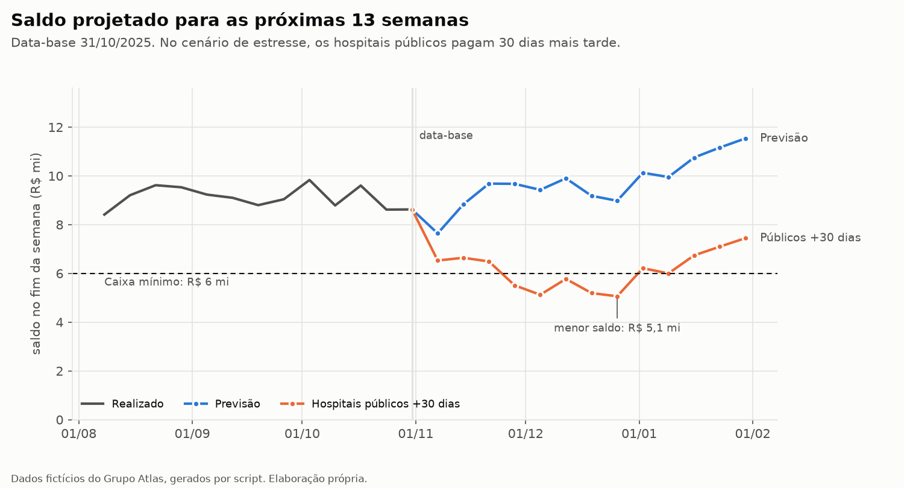
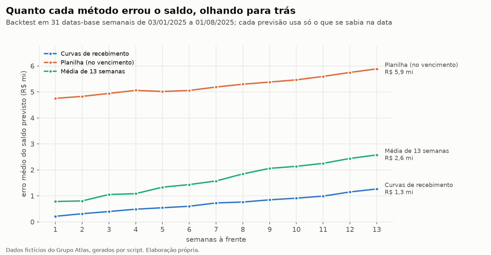
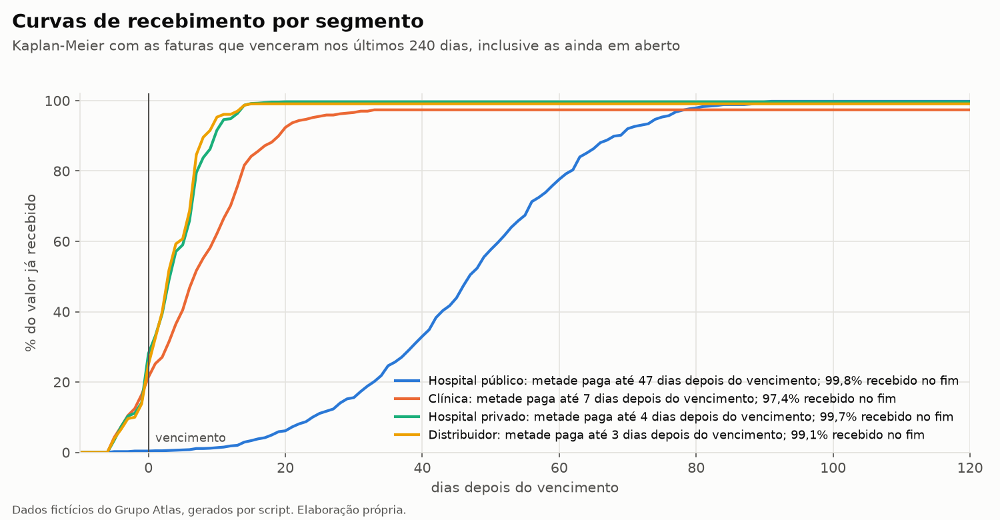

# Previsão de caixa de 13 semanas

Previsão de caixa semanal pelo **método direto**, em Python. Cada linha do fluxo vem de uma fonte que o controller reconhece: as faturas em aberto, as vendas previstas, os títulos de fornecedores e o calendário da folha e dos impostos. O projeto testa a previsão contra o passado (**backtest**) e responde quantos dias de atraso dos clientes o caixa aguenta antes de furar o mínimo.

> **Aviso:** o Grupo Atlas e todos os dados são fictícios, gerados por script com semente fixa (a mesma empresa do projeto de [fechamento mensal](https://github.com/Hidekiiiiii/fechamento-mensal-python)). Nenhum dado real foi usado.



## O que a previsão mostra (data-base 31/10/2025)

- **Cenário base:** o saldo sai de R$ 8,6 mi e não fica abaixo do caixa mínimo de R$ 6 mi. O ponto mais baixo é a 1ª semana (R$ 7,6 mi), quando a folha e um lote de fornecedores vencem juntos.
- **Folga:** o caixa aguenta **22 dias** de atraso adicional dos hospitais públicos, ou **21 dias** dos hospitais privados. Passou disso, fura o mínimo em dezembro, quando 13º salário, parcela do empréstimo, encargos e impostos caem em sequência.
- **Estresse (públicos +30 dias):** o saldo fica abaixo de R$ 6 mi por 5 semanas seguidas (de 22/11 a 26/12), com mínimo de R$ 5,1 mi.
- **Carteira:** dos R$ 27,6 mi em aberto, R$ 2,2 mi não devem entrar nas 13 semanas. Isso inclui R$ 1,6 mi vencidos há mais de 90 dias (R$ 0,9 mi deles de clínicas), que a curva de recebimento já trata como perda provável.

## Por que não usar a planilha "no vencimento"

O backtest refaz a previsão em 31 sextas-feiras de 2025, cada uma usando só o que se sabia naquela data, e compara com o extrato.



| Método | Erro nos recebimentos semanais (WAPE) | Erro médio do saldo na semana 4 | Erro médio do saldo na semana 13 |
|---|---|---|---|
| **Curvas de recebimento** (este projeto) | **9,1%** | **R$ 0,5 mi** | **R$ 1,3 mi** |
| Planilha (cliente paga no vencimento) | 26,7% | R$ 5,1 mi | R$ 5,9 mi |
| Média das últimas 13 semanas | 10,6% | R$ 1,1 mi | R$ 2,6 mi |

- **A planilha erra para cima e erra sempre.** Ela supõe que o vencido entra na semana seguinte. Mas 61% do que os hospitais públicos devem já está vencido, e, desde jun/25, eles pagam em média 53 dias depois do vencimento.
- **A média histórica acerta o volume, mas erra o momento.** Ela não sabe que a folha sai no 5º dia útil nem que dezembro tem 13º e parcela de empréstimo.
- **O modelo também erra, e o README mostra onde:** o saldo da semana 13 fica, em média, R$ 1,1 mi acima do realizado. Em jun/25, os hospitais públicos passaram a pagar cerca de 19 dias mais tarde (de 34 para 53 dias de atraso médio), e a curva leva semanas para incorporar uma mudança de comportamento. As compras também crescem um pouco antes das vendas.

## Como funciona

```
dados/ (ERP fictício)                        config/parametros.json
  receber.csv  pagar.csv  extrato.csv          regras de calendário e caixa mínimo
          │                                             │
          ▼                                             ▼
  curvas de recebimento ──► previsão diária por linha ──► 13 semanas ──► alertas e cenários
  (Kaplan-Meier por segmento)                                   │
                                                                ├─► saida/previsao_<data>.xlsx
                                                                └─► docs/*.png
```

| Linha do fluxo | Como é prevista |
|---|---|
| Recebimentos da carteira | Cada fatura em aberto é distribuída no tempo pela curva do seu segmento, *condicionada ao atraso que ela já tem*. |
| Recebimentos de vendas futuras | Venda por dia útil (nível das últimas 8 semanas × sazonalidade dos últimos 12 meses) × mix de segmentos, deslocada pelo prazo e pela curva de atraso. |
| Fornecedores | Títulos em aberto no vencimento + compras futuras (proporção compras/vendas dos últimos 90 dias e prazo médio dos fornecedores). |
| Folha, encargos, aluguel, empréstimo, 13º | Regras de calendário em `config/parametros.json` (ex.: folha no 5º dia útil; 13º em 30/11 e 20/12, antecipado se cair em fim de semana), com o último valor pago. |
| Impostos | Alíquota efetiva recente × faturamento do mês anterior. |
| Despesas diversas | Média por dia útil das últimas 13 semanas. |

### A curva de recebimento



A curva diz que fração do valor já foi recebida *x* dias depois do vencimento. O detalhe que importa: ela é estimada com **Kaplan-Meier**, que considera também as faturas que ainda não foram pagas. Se a conta usasse só as faturas pagas, as que estão atrasando agora ficariam de fora, e a curva diria que o cliente paga mais rápido do que paga.

Para uma fatura que já está 20 dias vencida, o modelo usa só a parte da curva depois do dia 20: a pergunta passa a ser "dado que ainda não pagou, quando paga?".

## Como rodar

```bash
pip install -r requirements.txt
python gerador/gerar_dados.py   # opcional: os dados já estão em dados/
python -m caixa                  # previsão na última data do extrato + backtest + gráficos
python -m caixa --data-base 2025-06-27 --sem-backtest
python -m pytest                 # 15 testes
```

A saída `saida/previsao_<data>.xlsx` tem 5 abas:
- **Fluxo 13 semanas:** as semanas abaixo do mínimo aparecem destacadas.
- **Alertas e cenários:** inclui a folga em dias de atraso por segmento.
- **Carteira em aberto:** recebimento esperado de cada fatura no horizonte.
- **Backtest.**
- **Premissas.**

## Testes

Os 15 testes cobrem:
- **Kaplan-Meier:** com e sem faturas em aberto.
- **Fechamento do fluxo:** saldo inicial + movimentos = saldo final.
- **Conservação da carteira:** o que entra no horizonte + o que não entra = total em aberto.
- **Calendário:** as datas de folha, 13º, empréstimo e impostos.
- **Método da planilha.**
- **Cenários:** mais atraso nunca melhora o caixa, e a folga calculada é o limite exato.
- **Backtest:** o realizado bate com o extrato.

Um teste garante que a previsão **não usa nada posterior à data-base**: ele apaga tudo o que aconteceu depois dela e exige uma previsão idêntica. Sem isso, o backtest não valeria nada. Para conferir que o teste funciona, ele foi rodado contra uma versão do código com esse vazamento, e falhou como deveria.

## Limitações

- **Dados fictícios:** os comportamentos (atraso dos públicos, perda das clínicas, 13º) foram embutidos no gerador. O teste real é rodar com a base de uma empresa.
- **Mudança de comportamento:** a curva usa 240 dias de histórico. Uma piora brusca de um cliente aparece aos poucos; um alerta de "atraso recente acima da curva" seria o próximo passo.
- **Curva por segmento, não por cliente:** com mais histórico, valeria ter curvas para os maiores clientes.
- **Sem incerteza explícita:** a previsão é o valor esperado. Faixas de confiança exigiriam simular a carteira fatura a fatura.
- **Feriados:** só os nacionais, numa lista fixa até 2026.
